# Albion Road Audio plugins

Free, open-source audio plugins for Linux (**CLAP** and **VST3**) by
[Albion Road Audio](https://www.albionroadaudio.co.uk). Each plugin shows up in your DAW as
**ARA <name>**. Every one is zero-latency, light on CPU, and uses the same Albion Road look,
with a dark/light theme that's shared across the whole range.

Downloads are on the [Releases](../../releases) page. Each zip has the plugin, install
instructions, licences and the full source for that build.

## Mixing and effects

| | Plugin | What it is |
|---|---|---|
| 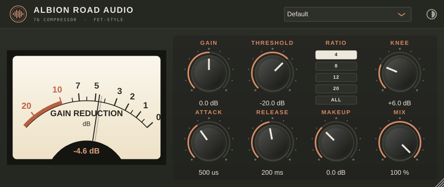 | [**Albion Road Audio 76 Compressor**](juce/compressor) | FET-style "76" compressor with presets, a gain-reduction meter and parallel mix |
| 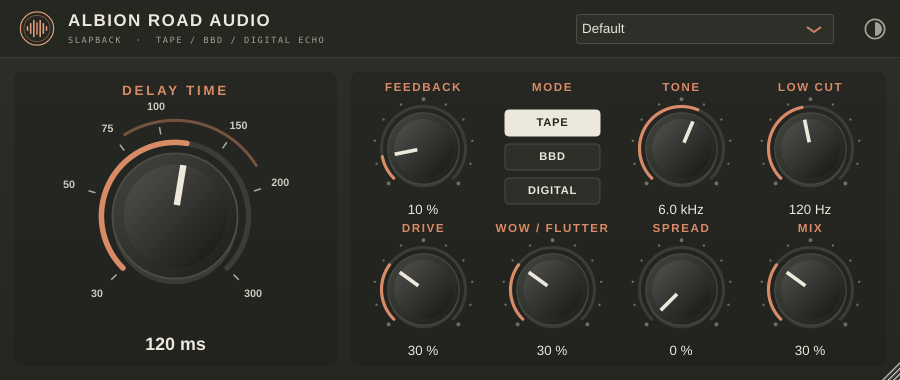 | [**Albion Road Audio Slapback**](juce/slapback) | Tape, BBD and digital slapback delay |
| 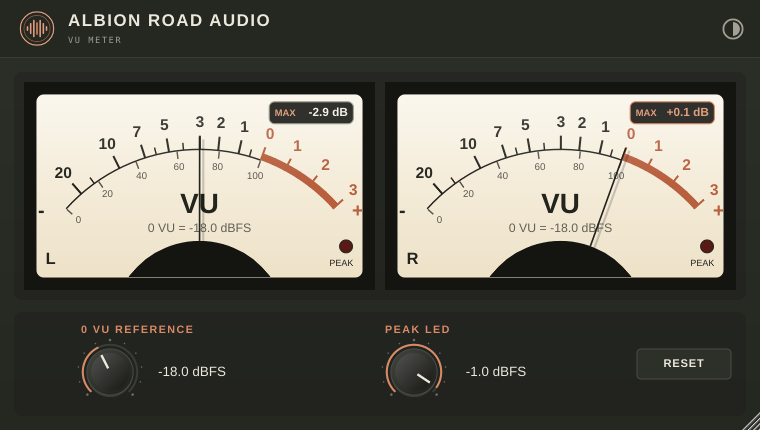 | [**Albion Road Audio VU Meter**](juce/vumeter) | Analog-style stereo VU meter; audio passes through untouched |
| 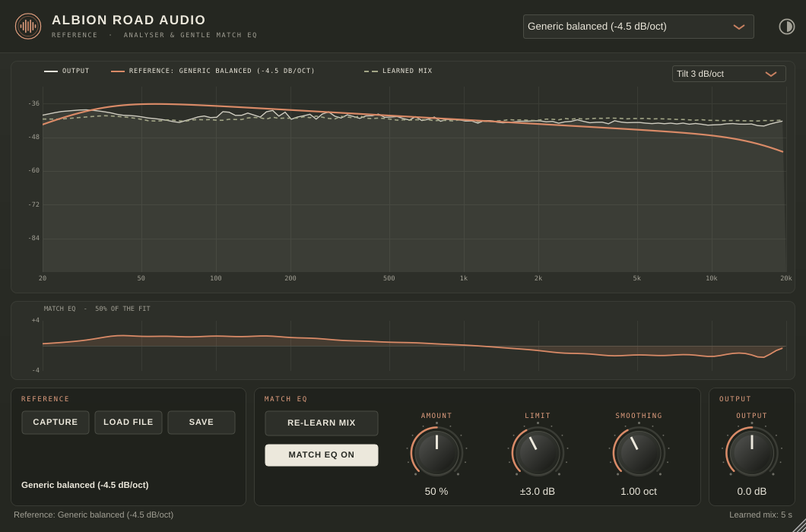 | [**Albion Road Audio Reference**](juce/reference) | Reference analyser with profiles, reference capture and a gentle match EQ |

## Surgical EQ series

Quick, focused EQs for each drum, plus bass and acoustic guitar. Each knob already sits in the right frequency area for that instrument, with enough room to tweak. Every knob has an on/off switch, and there's a spectrum graph above them.

| | Plugin | Bands |
|---|---|---|
| 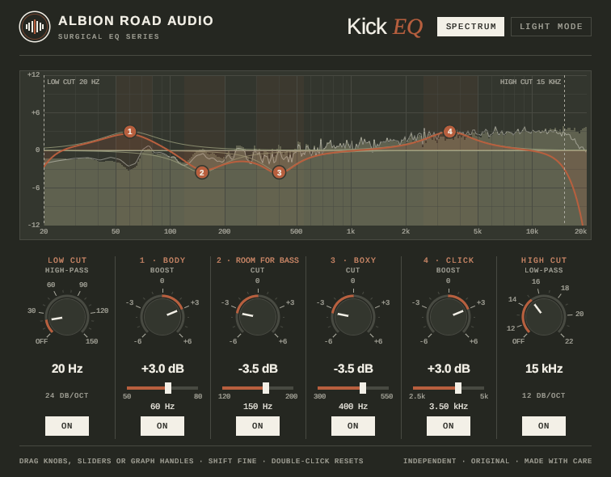 | [**Albion Road Audio Kick EQ**](rust/surgical-eq/kick_eq) | Low cut · Body · Room for bass · Boxy · Click · High cut |
| 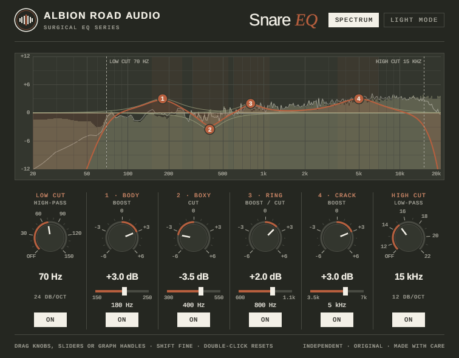 | [**Albion Road Audio Snare EQ**](rust/surgical-eq/snare_eq) | Low cut · Body · Boxy · Ring · Crack · High cut |
| 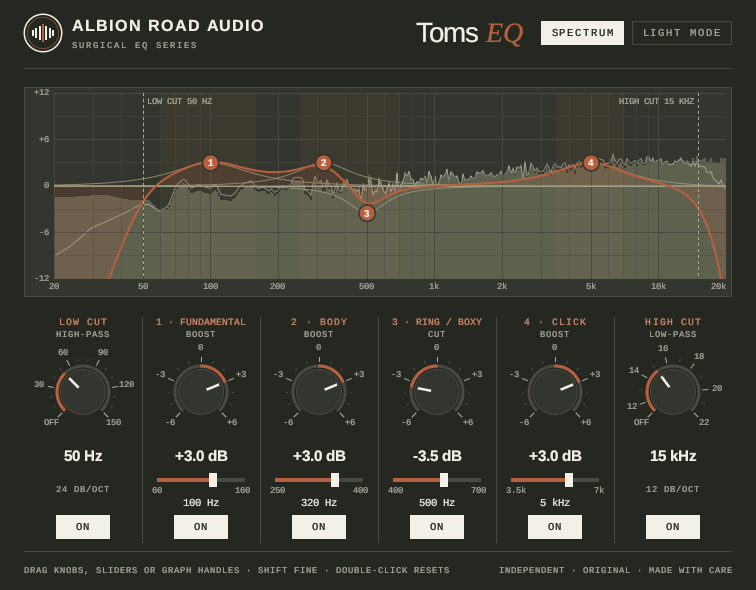 | [**Albion Road Audio Toms EQ**](rust/surgical-eq/toms_eq) | Low cut · Fundamental · Body · Ring/boxy · Click · High cut |
| 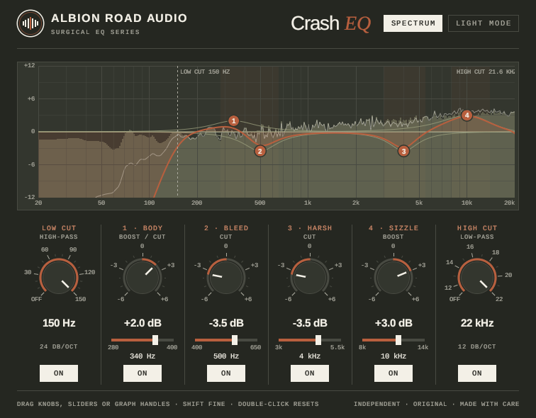 | [**Albion Road Audio Crash EQ**](rust/surgical-eq/crash_eq) | Low cut · Body · Bleed · Harsh · Sizzle · High cut |
| 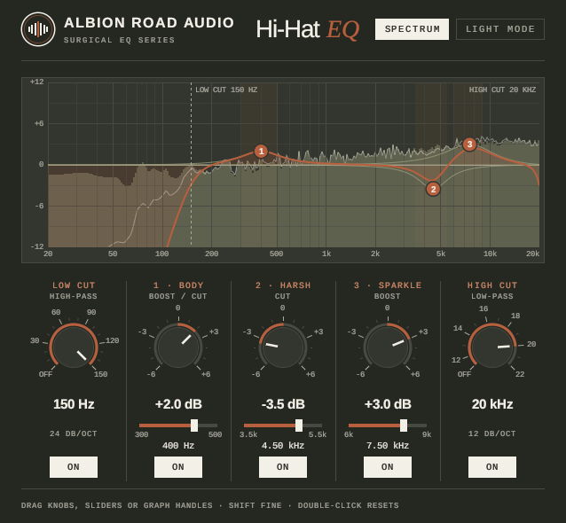 | [**Albion Road Audio Hi-Hat EQ**](rust/surgical-eq/hihat_eq) | Low cut · Body · Harsh · Sparkle · High cut |
| 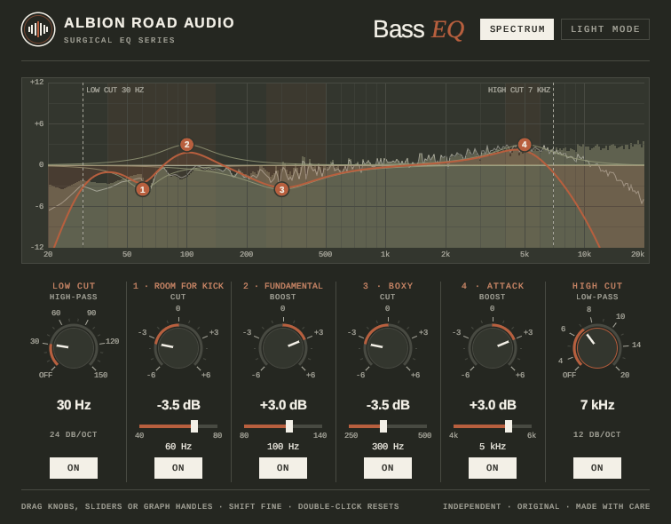 | [**Albion Road Audio Bass EQ**](rust/surgical-eq/bass_eq) | Low cut · Room for kick · Fundamental · Boxy · Attack · High cut |
| 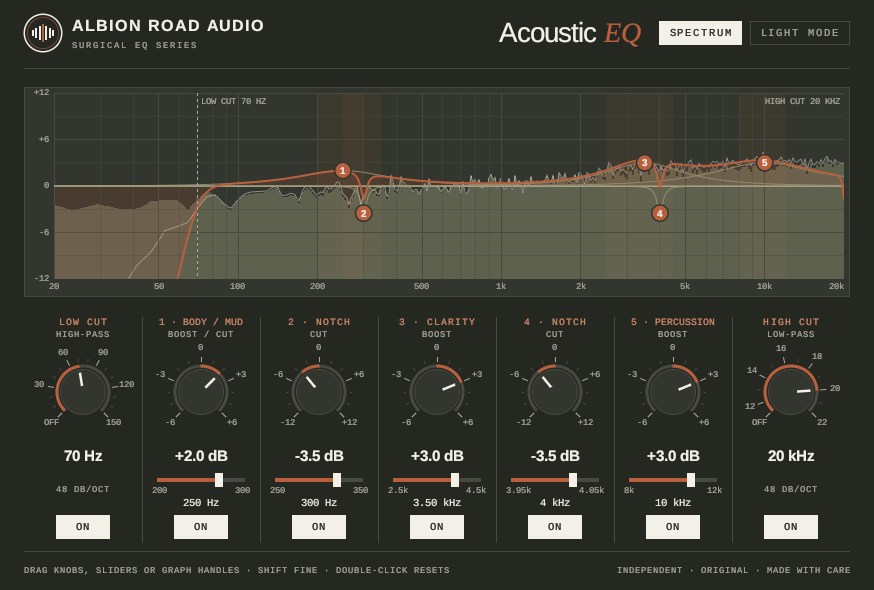 | [**Albion Road Audio Acoustic Guitar EQ**](rust/surgical-eq/acoustic_eq) | 48 dB/oct low cut · Body/mud · Notch · Clarity · Notch · Percussion · 48 dB/oct high cut |

## Drums

| | Plugin | What it is |
|---|---|---|
| 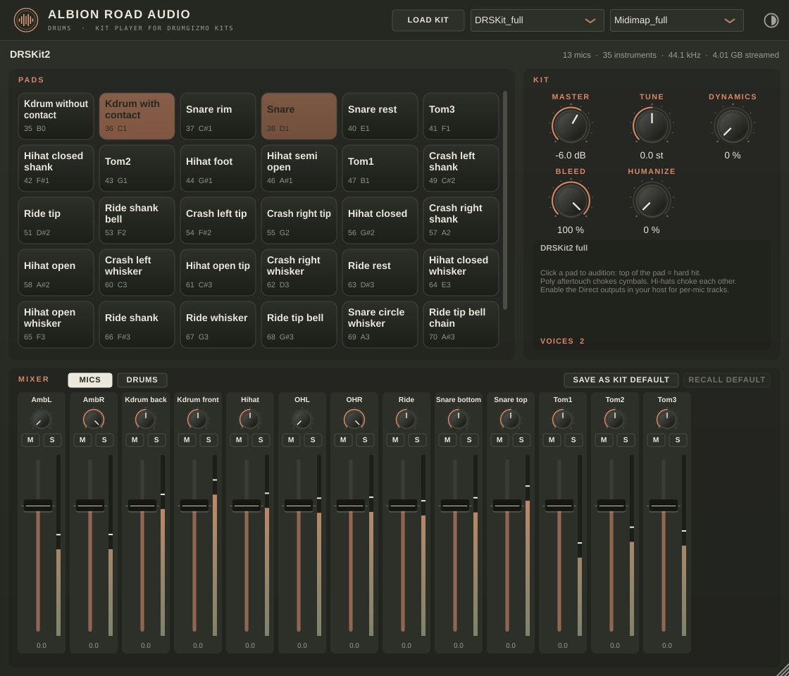 | [**Albion Road Audio Drums**](juce/drums) | Multi-mic drum kit player for [DrumGizmo](https://drumgizmo.org/) kits |
| 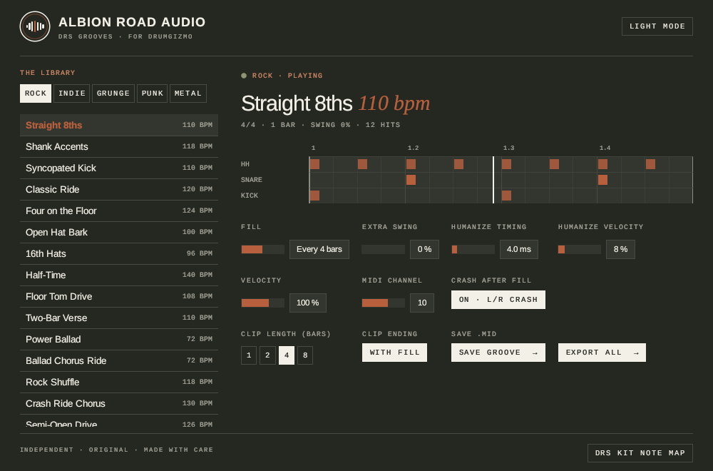 | [**Albion Road Audio DRS Grooves**](rust/drs-grooves/drs) | Rock, indie, grunge, punk and metal MIDI grooves for the DRS Kit, with .mid clip export |

## Repository layout

```
juce/                 JUCE + CMake plugins; each folder builds on its own
  compressor/ drums/ reference/ slapback/ vumeter/
rust/                 Rust + nih-plug plugins
  surgical-eq/        Cargo workspace: eqcore (shared DSP + GUI) and one crate per instrument
  drs-grooves/        Cargo workspace: the DRS Grooves plugin and drumlib (pattern engine)
releases/             package.py builds, checks and zips release builds into releases/dist/
```

## Building

Each project's README has the details. In short:

```sh
# JUCE plugins (needs CMake, Ninja and the usual X11/ALSA/JACK dev packages)
cd juce/compressor && cmake -B build -G Ninja -DCMAKE_BUILD_TYPE=Release && cmake --build build

# Rust plugins (needs a Rust toolchain, https://rustup.rs)
cd rust/surgical-eq && cargo xtask bundle -p kick_eq --release

# All release zips, checked to run on glibc 2.35+ (Ubuntu 22.04 and newer)
python3 releases/package.py
```

## Licence

All plugins are free software under the **GNU Affero General Public License v3.0 or later**
(see [`LICENSE`](LICENSE)). Each project's `NOTICE.md` lists the third-party components
(JUCE, the VST3 SDK, CLAP, nih-plug, egui, …) and their licences.
VST is a registered trademark of Steinberg Media Technologies GmbH.
