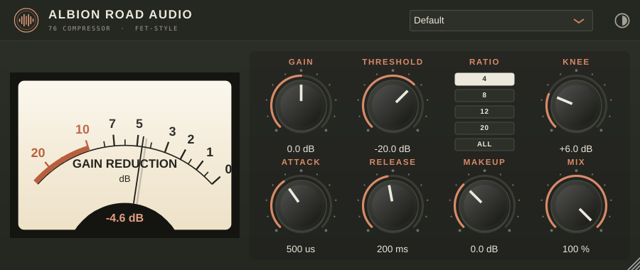

# Albion Road Audio 76 Compressor (FET style)



In your DAW it's listed as **ARA 76 Compressor**.

A vintage FET-style ("76" character) compressor in **CLAP** and **VST3** (plus Standalone),
built for **zero latency** and **very low CPU**.

## Controls

| Control   | Range                  | Notes |
|-----------|------------------------|-------|
| Gain      | -24 … +24 dB           | Input drive into the detector and colour stage |
| Threshold | -60 … 0 dBFS           | |
| Ratio     | 4 · 8 · 12 · 20 · ALL  | ALL over-compresses (slope 1.08), so loud hits get *quieter*, with extra colour, like the all-buttons-in trick |
| Knee      | 0 … 24 dB              | Quadratic soft knee |
| Attack    | 20 µs … 50 ms          | FET-fast at the bottom of the range |
| Release   | 30 ms … 2 s            | Program-dependent: sustained heavy GR stretches it up to ~2.5× |
| Makeup    | -12 … +24 dB           | |
| Mix       | 0 … 100 %              | Parallel compression against the untouched input |

There's also an analog **gain reduction meter** with a numeric readout and a **preset menu**
(20 factory presets for drums, vocals, bass, acoustic/electric guitar, piano, and a limiter).
Presets are also exposed as host programs.

## DSP / performance design

- **0 samples latency**: no lookahead, no oversampling, no FFTs.
- Stereo-linked peak detector → soft-knee gain computer in dB → branching attack/release.
  The `log2` is skipped entirely while the signal sits below the knee, and the `exp2` is skipped at 0 dB GR.
  All `exp`/`pow` coefficient work happens once per block.
- **Colour** is a clamped cubic polynomial (2nd + 3rd harmonics, about 1–2% THD near 0 dBFS).
  Its drive rises with gain reduction, the way a working FET's distortion does.
  Being 3rd-order, it can't create harmonics above 3× the input, so it adds character without needing oversampling.
  A 5 Hz DC blocker removes the offset from the even harmonics.
- Gain, Makeup and Mix are smoothed per sample (linear ramps) so automation is zipper-free.
- Measured: **~0.19% of one core** for 48 kHz stereo (about 40 ns per stereo sample, including the test harness).

## Build (Linux)

Deps (Debian/Ubuntu): see the VU Meter project README, same list.

```bash
cmake -B build -G Ninja -DCMAKE_BUILD_TYPE=Release
cmake --build build --target Albion76_CLAP Albion76_VST3 Albion76_Standalone
```

Outputs: `build/Albion76_artefacts/Release/{CLAP,VST3,Standalone}/`

## Install (user-local)

```bash
mkdir -p ~/.clap ~/.vst3
cp    "build/Albion76_artefacts/Release/CLAP/Albion Road Audio 76 Compressor.clap" ~/.clap/
cp -r "build/Albion76_artefacts/Release/VST3/Albion Road Audio 76 Compressor.vst3" ~/.vst3/
```

## IDs (don't change after release; saved projects depend on them)

CLAP `com.albionroadaudio.albion76` · manufacturer `Albr` · plugin `Ar76` ·
parameter IDs `gain threshold ratio knee attack release makeup mix`.

## Licence

Albion Road Audio 76 Compressor is free software under the **GNU Affero General Public License v3.0 or later**
(see `LICENSE`). Third-party components and their licences (JUCE, the VST3 SDK, CLAP)
are listed in `NOTICE.md`.

If you distribute builds, ship `LICENSE` and `NOTICE.md` with them and link to the
matching source code, e.g. this repository at the release's git tag.
