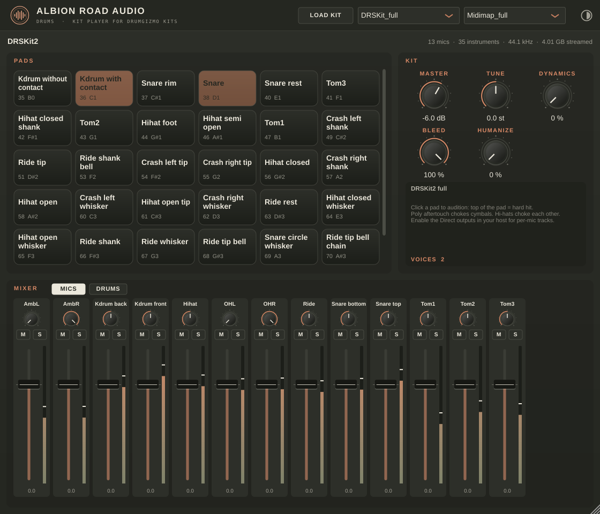

# Albion Road Audio Drums: DrumGizmo kit player



In your DAW it's listed as **ARA Drums**.

A drum instrument in **CLAP** and **VST3** (plus Standalone) that plays the multi-mic kits from
the open-source [DrumGizmo](https://drumgizmo.org/) project (DRSKit, CrocellKit, MuldjordKit,
Aasimonster, ShittyKit and others) in any modern host. Zero latency, low CPU, kits of many GB
without long loads.

## Using it

1. **LOAD KIT** and pick a kit's drumkit `.xml` (e.g. `DRSKit/DRSKit_full.xml`).
2. The header pickers switch between the kit's **variants** (`*_full`, `*_basic`, …) and **MIDI maps**.
   The matching map is chosen automatically (`DRSKit_full` → `Midimap_full`, or the kit's `defaultmidimap`).
3. **Pads**: one per mapped note. Click to audition (top of a pad = hard hit). Pads flash on MIDI hits.
4. **Kit** knobs:
   - **Master**: defaults to -6 dB, because kits sum many mics.
   - **Tune**: ±12 semitones for the whole kit (each drum's own **TUNE** adds to it).
   - **Dynamics**: extra velocity → level.
   - **Bleed**: master level of non-main mics, for kits that mark main channels (each drum's own
     **BLEED** scales it further).
   - **Humanize**: DrumGizmo's humanizer. 0 = off, 100% = DrumGizmo's defaults.
5. **Mixer**:
   - **MICS**: level, pan, mute and solo per microphone. Stereo pairs (`OHL/OHR`, `Room-L/Room-R`, …)
     are panned hard left/right automatically.
   - **DRUMS**: per instrument, a fader, mute, solo and **GATE**, **BLEED** and **TUNE** knobs.
     A drum's fader scales that drum in *every* mic, bleed included, so the room stays coherent.
     **BLEED** (0–100 %, default 100 %) sets how much of that drum the *other* mics pick up, e.g. the
     snare in the overheads and kick mic, on top of the kit Bleed knob. Some kits' bleed mics are partly
     out of phase with the close mic, so turning bleed down can thin a drum as well as dry it up.
     **TUNE** (±12 semitones, default 0) re-pitches just that drum, on top of the kit Tune knob.
     **GATE** cuts each hit once its level has fallen the set number of dB below that hit's own loudest point.
     - The level is RMS of the drum's main mics (10 ms attack, 60 ms release), so the reference is the body
       of the drum, not its transient click.
     - It's relative dB, not dBFS: soft and hard hits are shortened alike.
     - Range: Off, then -60 to -12 dB. On DRSKit's kick, -45 ≈ 1 s, -30 ≈ 0.5 s, -12 ≈ 0.25 s.
     - 15 ms hold, 20 ms close. Gated hits stop playing early, which also saves CPU.
6. **Direct outs**: 16 extra mono outputs (kit mic 1→16, post-fader, pre-pan). Enable them in your
   host for separate tracks. The main stereo out always carries the full mix.

Kit path, MIDI map and both mixers are saved with your project.

## DrumGizmo compatibility

Behaviour follows DrumGizmo 0.9.20's engine:
- **Kit formats**: both instrument formats are supported.
  - v2.0 selects samples by `power`, using the same close/diverse/random weighting DrumGizmo uses.
  - v1.0 uses fixed `<velocities>` groups.
- **Paths**: instrument files are relative to the kit folder, and samples relative to their instrument file. `filechannel` counts from 1.
- **Main channels**: `channelmap` `main=` follows DrumGizmo's "if any is set, unset means not main" rule.
- **Chokes**:
  - **Groups**: an instrument cuts the others in its `group` with a 68 ms fade (hi-hats).
  - **Directed**: `<chokes>` with `choketime`.
  - **Aftertouch**: polyphonic aftertouch chokes a cymbal over 450 ms. All-notes-off works too.
- **Velocity**: MIDI velocity is centred as DrumGizmo does. `normalized="true"` samples scale with velocity.
- **Sample rate**: taken from the WAV files when the kit doesn't declare one. Kits are converted to
  the host rate with 4-point Hermite interpolation, only when the rates differ.

Not implemented (yet): DrumGizmo's timing humanizer ("latency" filter), the power-map curve
editor, and a resampling-quality setting.

## Performance design

- **Memory-mapped WAVs**: nothing is decoded up front. Each file's attack (256 KB) is pre-faulted at load,
  and the rest is read ahead asynchronously (`MADV_WILLNEED`). Hits also queue a read-ahead on a
  background thread. File descriptors are closed after mapping, so thousand-file kits are fine.
- **Audio thread** never allocates, locks or does I/O. Kits load on a worker thread and are swapped in
  with an atomic pointer. Old kits are freed on the worker.
- **Rendering**: the decode is specialised per format (16/24/32-bit int, 32-bit float). When rates differ,
  each file frame is decoded once and then interpolated. Silent (muted/soloed-out) drums cost nothing.
- **Measured**: busy groove (16th hats, kick, snare, crash every bar) at 48 kHz:

  | Kit | CPU (one core) |
  |---|---|
  | DRSKit (13 mics, float) | ~1.9% |
  | ShittyKit (8 mics, 24-bit) | ~1.9% |
  | ShittyKit at its native 44.1 kHz | ~0.7% |

  DRSKit (4 GB) loads in ~0.1 s when warm, using ~150 MB resident.

## Build (Linux)

```bash
cmake -B build -G Ninja -DCMAKE_BUILD_TYPE=Release
cmake --build build --target AlbionDrums_CLAP AlbionDrums_VST3 AlbionDrums_Standalone
```

Dev tool: `-DALBION_BUILD_TOOLS=ON` builds `AlbionDrumsSnapshot <drumkit.xml> <out.png> [w h [drums]]`,
which renders the UI offscreen with a kit loaded, and `AlbionDrumsEngineTest <drumkit.xml>`, which checks
the per-drum Bleed and Tune against a real kit (e.g. DRSKit_full).

## IDs (don't change after release)

CLAP `com.albionroadaudio.drums` · manufacturer `Albr` · plugin `ArDr` ·
parameter IDs `master tune bleed humanize dynamics`.

## Licence

Albion Road Audio Drums is free software under the **GNU Affero General Public License v3.0 or later**
(see `LICENSE`). Third-party components and their licences (JUCE, the VST3 SDK, CLAP, DrumGizmo kits)
are listed in `NOTICE.md`.

If you distribute builds, ship `LICENSE` and `NOTICE.md` with them and link to the
matching source code, e.g. this repository at the release's git tag.
