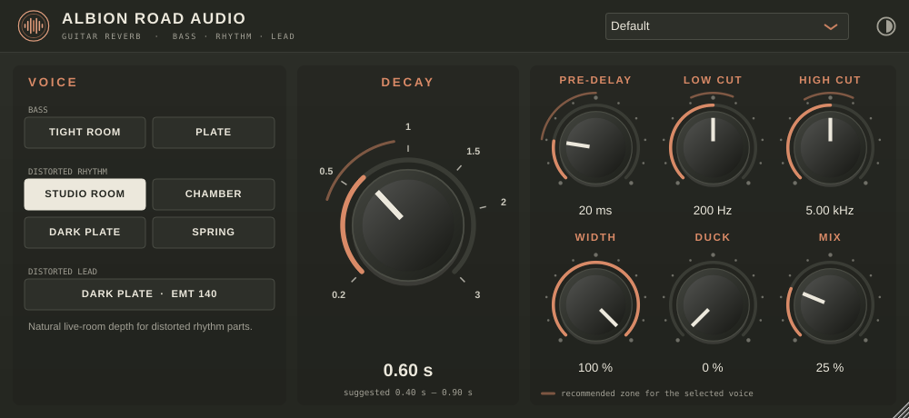

# Albion Road Audio Guitar Reverb



In your DAW it's listed as **ARA Guitar Reverb**.

A reverb made for bass and distorted electric guitar, in **CLAP** and **VST3** (plus Standalone),
in the Albion Road Audio house style. Pick what you're playing, and it loads the reverb type,
decay, pre-delay and filters that mix engineers use for that part. **Zero latency, low CPU.**

## Voices

Clicking a voice loads its recommended settings. A brass arc on the Decay, Pre-delay, Low Cut
and High Cut knobs then shows that voice's recommended zone, so you can tweak without losing the plot.

| Part | Voice | Decay | Low Cut | High Cut | Pre-delay |
|---|---|---|---|---|---|
| Bass | **Tight Room** (ambience) | 0.3 – 0.7 s | 300 Hz (250–400) | 4 kHz (3–5k) | 0–15 ms |
| Bass | **Plate** | 0.5 – 1.0 s | 300 Hz (250–400) | 4 kHz (3–5k) | 0–20 ms |
| Distorted rhythm | **Studio Room** | 0.4 – 0.9 s | 200 Hz (150–250) | 5 kHz (4–6k) | 20–50 ms |
| Distorted rhythm | **Chamber** | 0.4 – 0.9 s | 200 Hz (150–250) | 5 kHz (4–6k) | 20–50 ms |
| Distorted rhythm | **Dark Plate** | 0.8 – 1.5 s | 200 Hz (150–250) | 5 kHz (4–6k) | 20–50 ms |
| Distorted rhythm | **Spring** | 0.8 – 1.5 s | 200 Hz (150–250) | 5 kHz (4–6k) | 20–50 ms |
| Distorted lead | **Dark Plate · EMT 140** | 1.0 – 1.8 s | 250 Hz (200–300) | 6 kHz (5–7k) | 30 ms (20–40) |

The filters sit **before** the reverb, the way pros set up a reverb send. The low cut is a steep
24 dB/oct high-pass, so the low end of the bass or guitar never muddies the tail.

## Controls

| Control   | Range           | Notes |
|-----------|-----------------|-------|
| Decay     | 0.2 … 3.0 s     | RT60. The big knob. Double-click the readout to type a value |
| Pre-delay | 0 … 100 ms      | Gap before the reverb starts, so the pick attack stays clear |
| Low Cut   | 20 … 600 Hz     | 24 dB/oct high-pass before the reverb |
| High Cut  | 2 … 12 kHz      | 12 dB/oct low-pass before the reverb |
| Width     | 0 … 100 %       | Stereo width of the reverb (0 = mono) |
| Duck      | 0 … 100 %       | Turns the reverb down while you play (up to −16 dB) and lets it bloom in the gaps. Good on leads |
| Mix       | 0 … 100 %       | 0–50%: the dry signal stays at unity and the reverb comes up. 50%: both at unity. 100%: reverb only, **for use on a send/FX track** |

**16 factory presets**: one for each voice, plus Bass Subtle Glue, Rhythm Tight Wall, Rhythm Surf Spring,
Lead Ducked Solo, Lead Long Sustain, and 100%-wet "Send" versions for bass, rhythm and lead.
They're in the header menu and exposed as host programs.

## DSP

- **Rooms and chamber**: an 8-line feedback delay network (Householder matrix) with frequency-dependent
  decay (Jot absorption filters), four input diffusers, a tapped early-reflection pattern and slow
  delay modulation against metallic ringing. Three sizes: tight room, studio room, chamber.
- **Plates**: the Dattorro/Griesinger plate topology, with input bandwidth, tank damping and
  modulation set per voice (bright for bass, dark for rhythm, dark and lush for the EMT 140 lead).
- **Spring**: a three-spring tank. Each spring is a feedback loop with a 48-stage allpass dispersion
  chain (the descending "drip" chirp), a transit delay, damping and a small random wobble.
- Decay is calibrated: the measured RT60 is within ~5% of the knob for every voice, and the voices
  are level-matched to within 0.5 dB (`tools/IRTest.cpp`).
- Switching to a voice that uses a different engine crossfades over 80 ms.
- Mono or stereo input; the reverb is always stereo when the output is.
- Measured: **0.2% (plates), 0.4% (rooms) and 1.3% (spring) of one core** at 48 kHz stereo.

## Build (Linux)

```bash
cmake -B build -G Ninja -DCMAKE_BUILD_TYPE=Release
cmake --build build --target AlbionGuitarReverb_CLAP AlbionGuitarReverb_VST3 AlbionGuitarReverb_Standalone
```

Developer tools (`-DALBION_BUILD_TOOLS=ON`): `AlbionGuitarReverbSnapshot out.png` renders the GUI, and
`AlbionGuitarReverbIRTest [out_dir]` measures RT60, level, stability and CPU for every voice (and
writes the impulse responses as WAVs when given a folder).

## Install (user-local)

```bash
mkdir -p ~/.clap ~/.vst3
cp    "build/AlbionGuitarReverb_artefacts/Release/CLAP/Albion Road Audio Guitar Reverb.clap" ~/.clap/
cp -r "build/AlbionGuitarReverb_artefacts/Release/VST3/Albion Road Audio Guitar Reverb.vst3" ~/.vst3/
```

## IDs (don't change after release)

CLAP `com.albionroadaudio.guitarreverb` · manufacturer `Albr` · plugin `ArGv` ·
parameter IDs `voice decay predelay lowcut highcut width duck mix`.

`src/AlbionLookAndFeel.*` is a copy of the one in Albion 76. Keep them in sync (or move to a
shared repo) if the house style changes.

## Licence

Albion Road Audio Guitar Reverb is free software under the **GNU Affero General Public License v3.0 or later**
(see `LICENSE`). Third-party components and their licences (JUCE, the VST3 SDK, CLAP)
are listed in `NOTICE.md`.

If you distribute builds, ship `LICENSE` and `NOTICE.md` with them and link to the
matching source code, e.g. this repository at the release's git tag.
