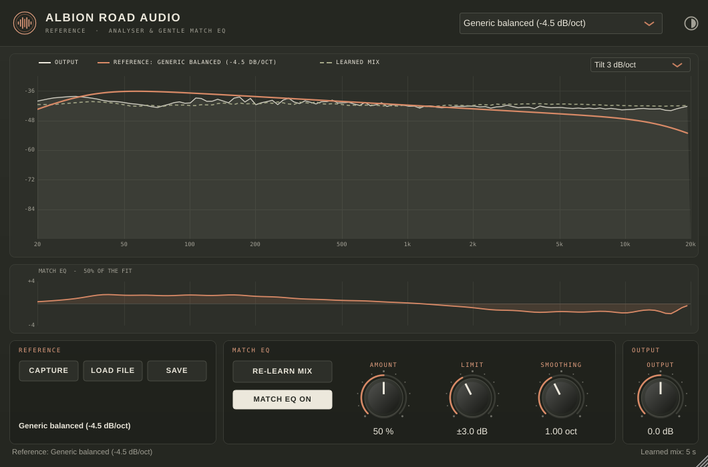

# Albion Road Audio Reference



In your DAW it's listed as **ARA Reference**.

A mix-referencing plugin in **CLAP** and **VST3** (plus Standalone), styled like
[albionroadaudio.co.uk](https://www.albionroadaudio.co.uk). Put it last on your mix or master bus.
**Zero latency, very low CPU** (~0.3% of one core with the match EQ active).

## What it does

- **Analyser**: live spectrum of your output (1/12-octave, ~300 ms averaging) with the reference
  curve and your learned mix laid over it. The reference and learned mix are *tonal shapes*
  (loudness removed), so they're drawn level-aligned to your output. The tilt can be 0, 3 (pink noise
  reads flat) or 4.5 dB/oct.
- **Profiles**: pick a reference from the header menu.
  - *Generic tonal balance*: four plain slopes (pink −3, bright −3.5, balanced −4.5, warm −5.5 dB/oct,
    with gentle sub and air roll-offs). These are **generic starting points, not measured genre data.**
  - *Your profiles*: anything you save. Stored as XML in
    `~/.config/Albion Road Audio/Reference Profiles/` (Linux), so they're available in every project.
- **Reference capture**:
  - **CAPTURE**: press it, play a reference track *through the plugin*, press again. Its long-term
    average spectrum becomes the reference.
  - **LOAD FILE**: analyse a WAV, AIFF, FLAC, OGG or MP3 directly.
  - **SAVE**: keep the current reference as a named profile.
- **Gentle match EQ**:
  1. **LEARN MIX**: press it, play your mix (the main/loudest sections work best), press again.
  2. The EQ is fitted to nudge your mix's *average tonal balance* towards the reference:
     - the difference (reference − mix, loudness removed) is smoothed over **SMOOTHING** octaves (default 1);
     - it's limited to ±**LIMIT** dB (default 3) and faded out below 30 Hz and above 16 kHz;
     - it's fitted with 15 broad bands (25 Hz to 16 kHz) and applied at **AMOUNT** (default 50%).

     With the defaults, a large tonal difference becomes a correction of about 1.5 dB.
  3. It's a *static* EQ: it only changes when you re-learn or move a control, so it never pumps.
     Changes glide at 12 dB/s.
  4. **MATCH EQ ON** bypasses it. The analyser keeps running and the bottom strip shows exactly what's applied.
- **OUTPUT**: ±12 dB trim.

Silent passages (below -60 dBFS) are ignored when capturing, learning or analysing files.

## Design

- **Audio thread:** copies samples into a lock-free FIFO, runs the EQ (minimum-phase biquads, no
  lookahead, so **0 samples latency**), and applies the output trim. A flat EQ is skipped entirely
  (bit-exact pass-through).
- **Analysis thread:** 8192-point FFTs every 4096 samples, L+R power-averaged, mapped to 120
  1/12-octave bands. It handles the live display and the long-term averages for capture and learn.
- **EQ fit:** least squares on 1 dB basis responses, refined four times on the true cascade response.
  It matches the target within ~0.8 dB from 40 Hz to 12 kHz.

Measured (`AlbionReferenceMatchTest`):
- white noise analyses flat to ±0.2 dB, pink noise at exactly −3 dB/oct;
- the measured output−input matches the fitted EQ to ~0.1 dB;
- EQ off is bit-exact;
- 0.34% of one core with the EQ active.

## Build (Linux)

```bash
cmake -B build -G Ninja -DCMAKE_BUILD_TYPE=Release
cmake --build build --target AlbionReference_CLAP AlbionReference_VST3 AlbionReference_Standalone
```

Dev tools: `-DALBION_BUILD_TOOLS=ON` builds `AlbionReferenceMatchTest` (headless functional test)
and `AlbionReferenceSnapshot <out.png>` (offscreen UI render).

## Install (user-local)

```bash
mkdir -p ~/.clap ~/.vst3
cp    "build/AlbionReference_artefacts/Release/CLAP/Albion Road Audio Reference.clap" ~/.clap/
cp -r "build/AlbionReference_artefacts/Release/VST3/Albion Road Audio Reference.vst3" ~/.vst3/
```

## IDs (don't change after release)

CLAP `com.albionroadaudio.reference` · manufacturer `Albr` · plugin `ArRf` ·
parameter IDs `amount maxdb smoothing eqon output tilt`.

## Licence

Albion Road Audio Reference is free software under the **GNU Affero General Public License v3.0 or later**
(see `LICENSE`). Third-party components and their licences (JUCE, the VST3 SDK, CLAP) are listed in `NOTICE.md`.

If you distribute builds, ship `LICENSE` and `NOTICE.md` with them and link to the
matching source code, e.g. this repository at the release's git tag.
