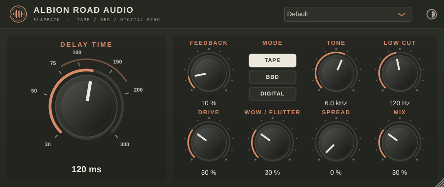

# Albion Road Audio Slapback



In your DAW it's listed as **ARA Slapback**.

A dedicated slapback delay in **CLAP** and **VST3** (plus Standalone), in the Albion Road Audio
house style (same look as Albion 76). **Zero latency, very low CPU.**

## Controls

| Control        | Range              | Notes |
|----------------|--------------------|-------|
| Delay Time     | 30 … 300 ms        | The big knob, with an ms scale. Brass arc marks the classic 80–180 ms slapback zone. Double-click the readout to type a value. Changes glide like a tape machine |
| Mode           | TAPE · BBD · DIGITAL | Sets the character (see below) |
| Feedback       | 0 … 80 %           | Slapback is usually 0–20%; more for rockabilly/surf |
| Tone           | 1 … 18 kHz         | High cut on the echo (inside the feedback loop) |
| Low Cut        | 20 Hz … 1 kHz      | Keeps the echo out of the low end and stops mud building up |
| Drive          | 0 … 100 %          | Saturation at the "record head" (0 to +18 dB into the clipper) |
| Wow / Flutter  | 0 … 100 %          | Pitch movement: amount, with the character set by Mode |
| Spread         | 0 … 100 %          | L echo earlier, R later (±15% of the time) for width. Works on mono sources too |
| Mix            | 0 … 100 %          | 0–50%: dry stays at unity and the echo comes up. 50%: both at unity. 50–100%: dry fades out |

**Modes**
- **Tape**: wow (0.6 Hz), flutter (6.5 Hz) and slow random drift; asymmetric soft saturation.
- **BBD**: chorus-like modulation and softer clipping. A steeper 4-pole low-pass that gets darker as
  the delay gets longer, like a real bucket-brigade chip's clock.
- **Digital**: clean. Modulation and drive only if you dial them in.

**22 factory presets**: Tape Slapback (Classic 50s, Rockabilly, Worn Machine, Hot Saturated),
Analog BBD (Warm, Dark Pedal, Chorused Slap), Digital (Clean, Wide Double, Haas Widener),
Guitar (Rockabilly Lead, Country Twang, Surf, Blues Room), Vocal (50s Slap, Modern Thickener,
Lo-Fi Telephone Slap), Snare/Drums (Slap Room, Rockabilly Smack, Short Ambience), Keys & Horns.
They're in the header menu and exposed as host programs.

## DSP / performance design

- **0 samples latency**: the dry path is untouched, and the echo is by definition late.
- Power-of-two circular buffer (bit-mask wrap), 4-point Hermite interpolation for clean modulation.
- TPT/Cytomic state-variable filters, with coefficients computed once per block.
- Modulation uses parabolic-sine LFOs and an LCG noise drift, so there are no `sin()` calls per sample.
- Rational-tanh soft clipper (no transcendental functions).
- Feedback, mix and time are smoothed per sample, so automation is click-free.
- Measured: **~0.24% of one core** (48 kHz stereo, Tape mode with wow, spread and feedback).

## Build (Linux)

```bash
cmake -B build -G Ninja -DCMAKE_BUILD_TYPE=Release
cmake --build build --target AlbionSlapback_CLAP AlbionSlapback_VST3 AlbionSlapback_Standalone
```

## Install (user-local)

```bash
mkdir -p ~/.clap ~/.vst3
cp    "build/AlbionSlapback_artefacts/Release/CLAP/Albion Road Audio Slapback.clap" ~/.clap/
cp -r "build/AlbionSlapback_artefacts/Release/VST3/Albion Road Audio Slapback.vst3" ~/.vst3/
```

## IDs (don't change after release)

CLAP `com.albionroadaudio.slapback` · manufacturer `Albr` · plugin `ArSb` ·
parameter IDs `time feedback mode tone lowcut drive wow spread mix`.

`src/AlbionLookAndFeel.*` is a copy of the one in Albion 76. Keep them in sync (or move to a
shared repo) if the house style changes.

## Licence

Albion Road Audio Slapback is free software under the **GNU Affero General Public License v3.0 or later**
(see `LICENSE`). Third-party components and their licences (JUCE, the VST3 SDK, CLAP)
are listed in `NOTICE.md`.

If you distribute builds, ship `LICENSE` and `NOTICE.md` with them and link to the
matching source code, e.g. this repository at the release's git tag.
