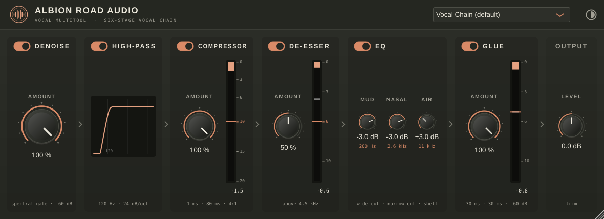

# Albion Road Audio Vocal Multitool



In your DAW it's listed as **ARA Vocal Multitool**.

A tried-and-tested six-stage vocal chain in one plugin, in **CLAP** and **VST3** (plus Standalone),
in the Albion Road Audio house style. Each stage is already dialled in, so you only decide *how much*.
Every stage has its own on/off switch next to its name. Switching a stage off fades it out smoothly (no clicks)
and dims its controls.

## The chain

| # | Stage | What it does | Control |
|---|---|---|---|
| 1 | **Denoise** | Spectral gate: anything below a −60 dB noise floor (room tone, hiss, rumble) is pulled down, bin by bin, while the voice passes untouched | Amount 0–100 % (100 % = up to 24 dB of reduction) |
| 2 | **High-pass** | 120 Hz, 24 dB/oct Butterworth | On/off switch only |
| 3 | **Compressor** | 1 ms attack, 80 ms release, 4:1. Clamps wild peaks to steady the vocal | Amount 0–100 % + gain-reduction meter |
| 4 | **De-esser** | Turns everything above ~4.5 kHz down while "s" and "t" sounds (5–10 kHz) stick out from the rest of the voice | Amount 0–100 % + meter |
| 5 | **EQ** | Mud: wide cut at 200 Hz · Nasal: narrow cut at 2.6 kHz · Air: gentle high shelf at 11 kHz | Three knobs (dB) |
| 6 | **Glue** | 30 ms attack, 30 ms release, threshold "all the way down" (−60 dB), low ratio. Smooths the EQ moves for a polished, upfront finish | Amount 0–100 % + gain-reduction meter |
| | **Output** | Trim | ±12 dB |

### How the one-knob compressors work

The recipe says "lower the threshold until you see −10 dB on the loudest peaks, then add +10 dB of
makeup" (and for the glue stage, "raise the ratio until you see about −5 dB, then match the level").
The plugin does that step for you. It keeps track of how loud the loudest moments of the vocal are
(it remembers them for 2 seconds, then lets go slowly at 0.5 dB per second) and places the threshold
(Compressor) or ratio (Glue) so that those moments get exactly that much reduction:

- **Compressor at 100 %** = −10 dB on the loudest peaks with +10 dB makeup. 50 % = −5 / +5, and so on.
- **Glue at 100 %** = about −5 dB with +5 dB makeup.

So peaks come out at roughly the level they went in, and everything underneath comes up. The brass tick
on each meter marks the recipe target.

### Presets

Vocal Chain (default), Gentle, Upfront Rock Vocal, Spoken Word / Podcast, Bright Singer (tame the top),
Dark Singer (open it up), and Clean Slate (everything off). They're in the header menu and exposed as host programs.

## Latency

The denoiser works on 2048-sample FFT frames, so the plugin reports **2048 samples of latency** at 44.1/48 kHz
(4096 at 88.2/96 kHz). Your DAW compensates for it automatically. It's a mixing tool; for live tracking,
monitor without it. CPU use is about 2 % of one core at 48 kHz stereo.

## Build (Linux)

```bash
cmake -B build -G Ninja -DCMAKE_BUILD_TYPE=Release
cmake --build build --target AlbionVocalMultitool_CLAP AlbionVocalMultitool_VST3 AlbionVocalMultitool_Standalone
```

Developer tools (`-DALBION_BUILD_TOOLS=ON`): `AlbionVocalMultitoolSnapshot out.png [comp1On,eqOn…]` renders the GUI
(optionally with those switches off), and
`AlbionVocalMultitoolDspTest` measures every stage against the recipe (latency, transparency, denoise depth,
filter response, gain reduction, makeup, de-essing, EQ gains, CPU).

## Install (user-local)

```bash
mkdir -p ~/.clap ~/.vst3
cp    "build/AlbionVocalMultitool_artefacts/Release/CLAP/Albion Road Audio Vocal Multitool.clap" ~/.clap/
cp -r "build/AlbionVocalMultitool_artefacts/Release/VST3/Albion Road Audio Vocal Multitool.vst3" ~/.vst3/
```

## IDs (don't change after release)

CLAP `com.albionroadaudio.vocalmultitool` · manufacturer `Albr` · plugin `ArVm` ·
parameter IDs `denoise hpf comp1 deess mud nasal air comp2 output denoiseOn comp1On deessOn eqOn comp2On`.

`src/AlbionLookAndFeel.*` is a copy of the one in Albion 76. Keep them in sync (or move to a
shared repo) if the house style changes.

## Licence

Albion Road Audio Vocal Multitool is free software under the **GNU Affero General Public License v3.0 or later**
(see `LICENSE`). Third-party components and their licences (JUCE, the VST3 SDK, CLAP)
are listed in `NOTICE.md`.

If you distribute builds, ship `LICENSE` and `NOTICE.md` with them and link to the
matching source code, e.g. this repository at the release's git tag.
