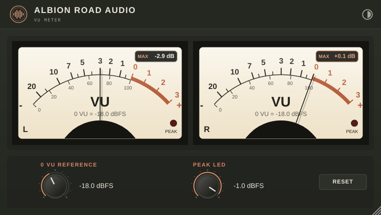

# Albion Road Audio VU Meter



In your DAW it's listed as **ARA VU Meter**.

A classic analog-style stereo VU meter. Audio passes through **untouched**;
the plugin only measures.

- **True VU ballistics** (IEC 60268-17): a second-order needle model
  (ζ = 0.81, ωₙ = 13.42 rad/s) reaches 99% of a step in 300 ms with ~1.3% overshoot.
  The model runs per-sample on the audio thread, so it doesn't depend on GUI frame rate.
- **Average-responding, RMS-calibrated**, like the real thing: a sine at the
  reference level reads exactly 0 VU.
- **Moving-coil scale**: linear in voltage (0 VU = 100%, +3 VU = 141%), with the
  red zone, percentage sub-scale, and needle rest pins.
- **0 VU reference**: -30 to 0 dBFS (default -18 dBFS).
- **MAX reading** per channel (top right of each meter): the highest point the needle has
  reached, in dB VU (e.g. "-3.0 dB"). It turns red at 0 VU and above, and keeps tracking while the
  window is closed. Changing the 0 VU reference re-labels it correctly.
- **Peak LED** per channel: lights when the sample peak crosses its threshold
  (default -1 dBFS) and holds for 1.5 s.
- **RESET** (or click a meter) clears the MAX readings and peak LEDs.
- Albion Road Audio house style (matches albionroadaudio.co.uk): cream paper, ink, burnt-orange accents.
- Mono or stereo; resizable editor (fixed aspect ratio).

Formats: **CLAP** (via [clap-juce-extensions](https://github.com/free-audio/clap-juce-extensions)),
**VST3**, and **Standalone** (handy for quick testing). JUCE and the extensions are
fetched by CMake `FetchContent`.

## Linux build deps (Debian/Ubuntu)

```bash
sudo apt install build-essential cmake ninja-build git pkg-config \
  libasound2-dev libjack-jackd2-dev libfreetype-dev libfontconfig1-dev \
  libx11-dev libxcomposite-dev libxcursor-dev libxext-dev libxinerama-dev \
  libxrandr-dev libxrender-dev libglu1-mesa-dev mesa-common-dev
```

## Build

```bash
cmake -B build -G Ninja -DCMAKE_BUILD_TYPE=Release
cmake --build build --target VuMeter_CLAP VuMeter_VST3 VuMeter_Standalone
```

Outputs land in `build/VuMeter_artefacts/Release/{CLAP,VST3,Standalone}/`.

## Install (user-local)

```bash
mkdir -p ~/.clap ~/.vst3
cp    "build/VuMeter_artefacts/Release/CLAP/Albion Road Audio VU Meter.clap" ~/.clap/
cp -r "build/VuMeter_artefacts/Release/VST3/Albion Road Audio VU Meter.vst3" ~/.vst3/
```
Rescan in Bitwig / Reaper / Ardour etc.

## Validate

- [clap-validator](https://github.com/free-audio/clap-validator): `clap-validator validate ~/.clap/"Albion Road Audio VU Meter.clap"`
- [pluginval](https://github.com/Tracktion/pluginval) for the VST3

## Before you ship

- IDs are now final Albion Road Audio values (`com.albionroadaudio.vumeter`, manufacturer `Albr`, plugin `ArVu`).
  **Changing the CLAP ID / plugin code from here on breaks saved projects.**
- Parameter IDs (`reference`, `peakled`) are persisted in host sessions; treat them as stable.

## Licence

Albion Road Audio VU Meter is free software under the **GNU Affero General Public License v3.0 or later**
(see `LICENSE`). Third-party components and their licences (JUCE, the VST3 SDK, CLAP)
are listed in `NOTICE.md`.

If you distribute builds, ship `LICENSE` and `NOTICE.md` with them and link to the
matching source code, e.g. this repository at the release's git tag.
