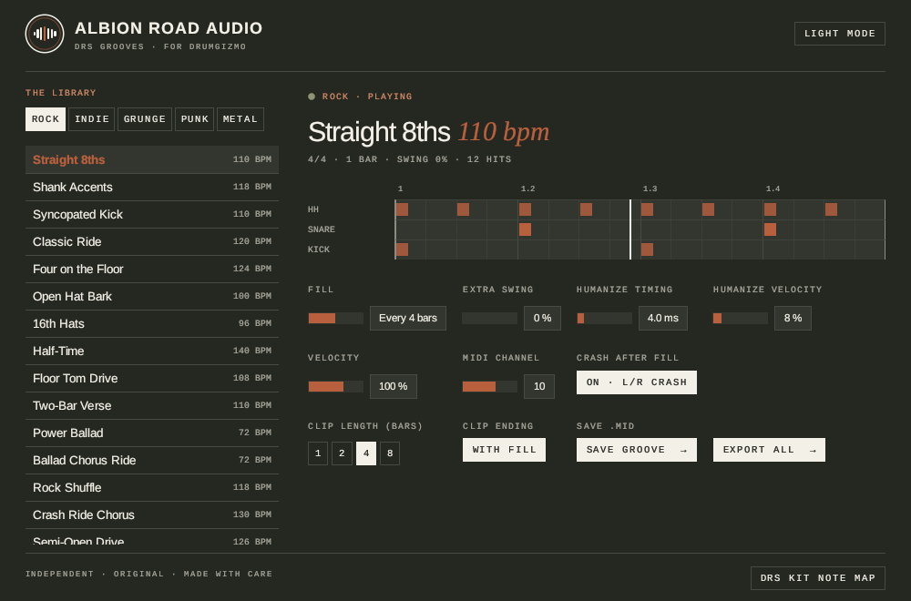

# Albion Road Audio DRS Grooves



Rock, indie, grunge, punk and metal grooves by **Albion Road Audio**, written for the free
[DrumGizmo](https://drumgizmo.org/) DRS Kit. Pair it with
Albion Road Audio Drums (or DrumGizmo itself) loaded with the DRS Kit.

- **72 grooves and 24 fills** across rock, indie, grunge, punk and metal, using the kit's
  articulations: closed/shank/semi-open/open hats, ride tip/bell/shank, both crashes,
  three toms, snare rim and more.
- A pattern browser with a step-grid view that follows the playhead, a DRS Kit note map,
  and **MIDI clip export** (see below).
- Formats: **CLAP** and **VST3** for 64-bit Linux. It's a note effect (MIDI in → MIDI out).

In your DAW it's listed as **ARA DRS Grooves**.

## Use

Put **Albion Road Audio DRS Grooves** in the note FX chain of the track that holds Albion Road Audio Drums or DrumGizmo
with the DRS Kit (in Bitwig, under Note FX), and press play.

| Parameter | What it does |
|---|---|
| Pattern | Groove to play ("Genre › Name"). Changes take effect at the next bar line. |
| Fill | Swap in a fill from the same genre every 2/4/8/16 bars (or Off). |
| Crash after fill | Crash cymbal on the downbeat after each fill. |
| Extra swing | Added on top of the pattern's own swing (100% = triplet feel). |
| Humanize timing / velocity | Small, repeatable random offsets. |
| Velocity | Scales all velocities. |
| MIDI channel | Output channel (default 10). |

## Getting the grooves onto a MIDI track

Bitwig (like most DAWs) records the MIDI going *into* a track, not what a note effect
generates, so arming record won't capture DRS Grooves. Export clips instead:

| Control | What it does |
|---|---|
| Clip length (bars) | 1, 2, 4 or 8 bars per clip (never shorter than the groove itself). |
| Clip ending | **With fill** replaces the clip's last bar with one of the genre's fills. 1-bar clips never get a fill. |
| Save groove → | Writes the selected groove as one `.mid` clip. |
| Export all → | Writes every groove with these settings, plus every fill as its own clip. |

The clips use the groove's tempo, your **Extra swing**, **Velocity** and **MIDI channel**.
Humanize isn't applied, so the clips are clean to edit. Files go to
`~/Music/Albion Road Audio/DRS Grooves/<Genre>/`, named like
`Straight 8ths - 110 BPM - 4 bars + fill.mid`, and fills go in `<Genre>/Fills/`. Saving again
overwrites a clip with the same name.

In Bitwig, add `~/Music/Albion Road Audio` once under Settings → Locations (My Library folders).
The clips then show up in the browser, ready to drag onto the Albion Road Audio Drums track.

The note map comes from the kit's published MIDI note labels. If a drum plays the wrong
articulation on your copy of the kit, please report it.

## Install

See `INSTALL.txt` in the release zip. In short: copy the `.clap` file to `~/.clap/` and/or the
`.vst3` folder to `~/.vst3/`, then rescan plugins in your DAW.

## Build from source

The workspace (`rust/drs-grooves`) holds this plugin and `drumlib`, the pattern engine it uses.

```sh
cargo xtask bundle -p drs_grooves --release
```

## Licence

Free software under the **GNU Affero General Public License v3.0 or later** (see `LICENSE`).
Third-party components are listed in `NOTICE.md`, with their full licence texts in
`THIRD-PARTY-LICENSES.txt`.

Albion Road Audio · https://www.albionroadaudio.co.uk
