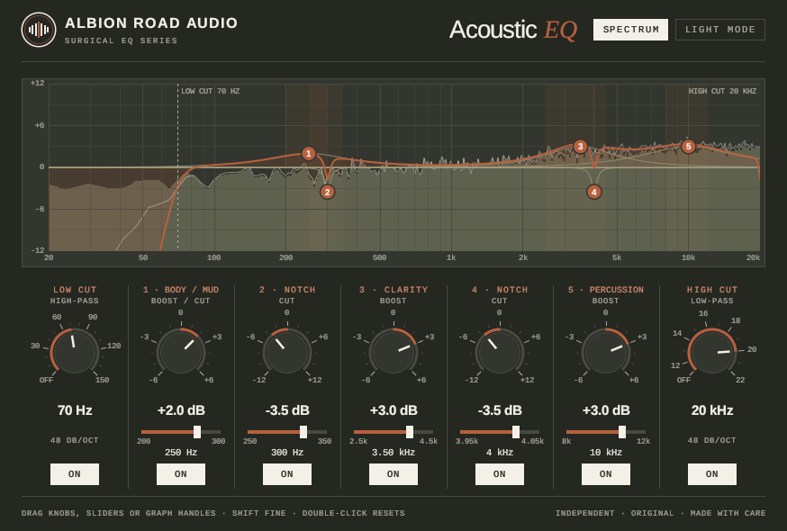

# Albion Road Audio Acoustic Guitar EQ



Part of the **Albion Road Audio Surgical EQ series**: a quick, focused EQ for miked acoustic
guitar. Each knob is already in the right area, with enough room to tweak.

Formats: **CLAP** and **VST3** for 64-bit Linux. Mono or stereo, zero latency.

In your DAW it's listed as **ARA Acoustic EQ**.

## Controls

| Knob | Move | Frequency zone | Default | What it's for |
|---|---|---|---|---|
| Low cut | high-pass | Off / 10 … 150 Hz | 70 Hz | **48 dB/oct**; a sharp cut for room noise and handling thumps below the low E (82 Hz) |
| 1 · Body / mud | boost / cut | 200–300 Hz | 250 Hz | Analog bell: boost for warmth if thin, cut if boomy or muddy |
| 2 · Notch | cut | 250–350 Hz | 300 Hz | Narrow notch (±12 dB) for a ringing low-mid resonance |
| 3 · Clarity | boost | 2.5–4.5 kHz | 3.5 kHz | Analog bell, wide: clarity and shine |
| 4 · Notch | cut | 3.95–4.05 kHz | 4 kHz | Narrow notch (±12 dB) for a harsh upper-mid resonance |
| 5 · Percussion | boost | 8–12 kHz | 10 kHz | Analog bell: strumming and picking crispness |
| High cut | low-pass | Off / 12 … 22 kHz | 20 kHz | **48 dB/oct**; removes inaudible content above 20 kHz for headroom |

- **Bells** are ±6 dB, with 0 dB at 12 o'clock. They use the analog bell shape, so the 10 kHz
  boost keeps its true width instead of getting squeezed near the top of the spectrum.
- **Notches** are ±12 dB and narrow: at full cut, the 4 kHz notch leaves 3.5 and 4.5 kHz within
  1 dB. Sweep the slider to land exactly on the ringing frequency.
- "Move" is a hint of the usual direction, not a limit.
- The **slider** under each band knob moves its frequency within its zone.
- Every knob has its own **On/Off** switch.
- The **graph** shows the incoming audio as a solid fill, the processed audio as a faint
  line, and the EQ curve. The shaded areas are the band zones. Drag the numbered handles:
  left/right moves frequency, up/down moves gain.
- **Spectrum** turns the analyser off. **Light/Dark mode** switches the theme, and the choice is
  shared by every Albion Road Audio plugin.
- Knobs: drag vertically, hold Shift for fine control, double-click to reset, scroll to step.

The body, clarity and percussion bands and the 70 Hz / 20 kHz cuts follow
[musicguymixing.com's acoustic guitar EQ guide](https://www.musicguymixing.com/eq-acoustic-guitar/).
If the guitar is the only low-end instrument, keep the low cut at 70 Hz; with bass in the mix,
try it higher.

## Install

See `INSTALL.txt` in the release zip. In short: copy the `.clap` file to `~/.clap/` and/or the
`.vst3` folder to `~/.vst3/`, then rescan plugins in your DAW.

## Build from source

The series shares one Rust workspace (`eqcore` holds the DSP and GUI; each instrument crate
only defines its bands). See the workspace `README.md`:

```sh
cargo xtask bundle -p acoustic_eq --release
```

## Licence

Free software under the **GNU Affero General Public License v3.0 or later** (see `LICENSE`).
Third-party components are listed in `NOTICE.md`, with their full licence texts in
`THIRD-PARTY-LICENSES.txt`.

Albion Road Audio · https://www.albionroadaudio.co.uk
