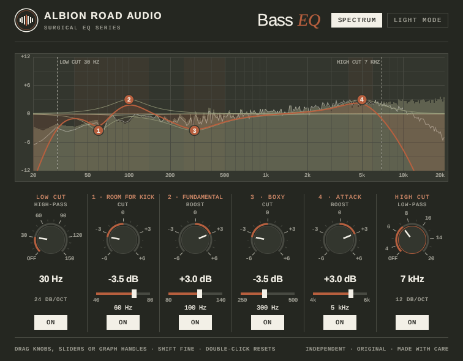

# Albion Road Audio Bass EQ



Part of the **Albion Road Audio Surgical EQ series**: a quick, focused EQ for bass guitar. Each
knob is already in the right area for bass, with enough room to tweak.

Formats: **CLAP** and **VST3** for 64-bit Linux. Mono or stereo, zero latency.

In your DAW it's listed as **ARA Bass EQ**.

## Controls

| Knob | Move | Frequency zone | Default | What it's for |
|---|---|---|---|---|
| Low cut | high-pass | Off / 10 … 150 Hz | 30 Hz | 24 dB/oct; removes low rumble and leaves room for the kick |
| 1 · Room for kick | cut | 40–80 Hz | 60 Hz | A small dip where the kick's fundamental sits, so they don't fight |
| 2 · Fundamental | boost | 80–140 Hz | 100 Hz | Thickness and weight |
| 3 · Boxy | cut | 250–500 Hz | 300 Hz | A wide cut for boxy, muddy low mids |
| 4 · Attack | boost | 4–6 kHz | 5 kHz | String attack and definition |
| High cut | low-pass | Off / 4 … 20 kHz | 7 kHz | 12 dB/oct; rolls off fret noise and hiss above the bass |

- Every band is **±6 dB**, with 0 dB at 12 o'clock. "Move" is a hint of the usual
  direction, not a limit.
- The high cut reaches down to **4 kHz**, unlike the drum EQs, because bass is usually rolled
  off well below the cymbals' range. Sweep it down until you hear the top of the strings go.
- The **slider** under each band knob moves its frequency within its zone.
- Every knob has its own **On/Off** switch.
- The **graph** shows the incoming audio as a solid fill, the processed audio as a faint
  line, and the EQ curve. The shaded areas are the band zones. Drag the numbered handles:
  left/right moves frequency, up/down moves gain.
- **Spectrum** turns the analyser off. **Light/Dark mode** switches the theme, and the choice is
  shared by every Albion Road Audio plugin.
- Knobs: drag vertically, hold Shift for fine control, double-click to reset, scroll to step.

Bands follow [musicguymixing.com's bass guitar EQ guide](https://www.musicguymixing.com/bass-guitar-eq/).

## Install

See `INSTALL.txt` in the release zip. In short: copy the `.clap` file to `~/.clap/` and/or the
`.vst3` folder to `~/.vst3/`, then rescan plugins in your DAW.

## Build from source

The series shares one Rust workspace (`eqcore` holds the DSP and GUI; each instrument crate
only defines its bands). See the workspace `README.md`:

```sh
cargo xtask bundle -p bass_eq --release
```

## Licence

Free software under the **GNU Affero General Public License v3.0 or later** (see `LICENSE`).
Third-party components are listed in `NOTICE.md`, with their full licence texts in
`THIRD-PARTY-LICENSES.txt`.

Albion Road Audio · https://www.albionroadaudio.co.uk
