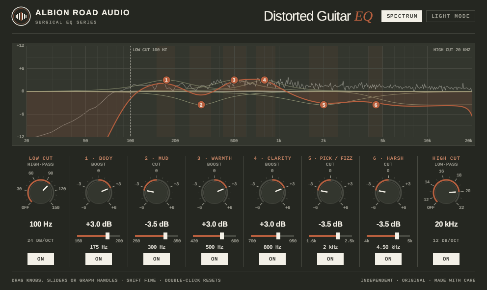

# Albion Road Audio Distorted Guitar EQ



Part of the **Albion Road Audio Surgical EQ series**: a quick, focused EQ for distorted electric
guitar. Each knob is already in the right area for a distorted guitar, with enough room to tweak.

Formats: **CLAP** and **VST3** for 64-bit Linux. Mono or stereo, zero latency.

In your DAW it's listed as **ARA Distorted Guitar EQ**.

## Controls

| Knob | Move | Frequency zone | Default | What it's for |
|---|---|---|---|---|
| Low cut | high-pass | Off / 10 … 150 Hz | 100 Hz | 24 dB/oct; cleans up rumble and low-end mess. Sweep it to check you're not losing tone |
| 1 · Body | boost | 150–200 Hz | 175 Hz | Low body. Go easy: mud starts just above |
| 2 · Mud | cut | 250–350 Hz | 300 Hz | Clears mud. Often better than boosting higher, where harshness lives |
| 3 · Warmth | boost | 420–600 Hz | 500 Hz | Warmth from the guitar's body and fundamentals |
| 4 · Clarity | boost | 700–950 Hz | 800 Hz | The "magic" clarity area, a safe place to boost |
| 5 · Pick / fizz | cut | 1.6–2.5 kHz | 2 kHz | A wide, subtle cut for pick click and grating fizz, if the track is tiring to listen to |
| 6 · Harsh | high-shelf cut | 4–5 kHz | 4.5 kHz | Softens grating distortion more musically than a low-pass |
| High cut | low-pass | Off / 12 … 22 kHz | 20 kHz | 12 dB/oct; an optional final clean-up above the shelf |

- Every band is **±6 dB**, with 0 dB at 12 o'clock. "Move" is a hint of the usual
  direction, not a limit.
- The **slider** under each band knob moves its frequency within its zone.
- Every knob has its own **On/Off** switch.
- The **graph** shows the incoming audio as a solid fill, the processed audio as a faint
  line, and the EQ curve. The shaded areas are the band zones. Drag the numbered handles:
  left/right moves frequency, up/down moves gain.
- **Spectrum** turns the analyser off. **Light/Dark mode** switches the theme, and the choice is
  shared by every Albion Road Audio plugin.
- Knobs: drag vertically, hold Shift for fine control, double-click to reset, scroll to step.

Bands follow [musicguymixing.com's distorted guitar EQ guide](https://www.musicguymixing.com/distorted-guitar-eq/).
The guide gives no Q or dB amounts, so the widths and zones are our choices.

## Install

See `INSTALL.txt` in the release zip. In short: copy the `.clap` file to `~/.clap/` and/or the
`.vst3` folder to `~/.vst3/`, then rescan plugins in your DAW.

## Build from source

The series shares one Rust workspace (`eqcore` holds the DSP and GUI; each instrument crate
only defines its bands). See the workspace `README.md`:

```sh
cargo xtask bundle -p guitar_eq --release
```

## Licence

Free software under the **GNU Affero General Public License v3.0 or later** (see `LICENSE`).
Third-party components are listed in `NOTICE.md`, with their full licence texts in
`THIRD-PARTY-LICENSES.txt`.

Albion Road Audio · https://www.albionroadaudio.co.uk
