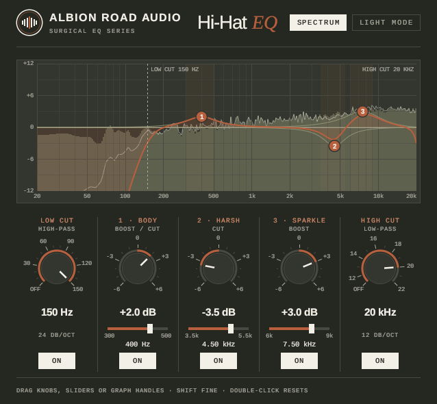

# Albion Road Audio Hi-Hat EQ



Part of the **Albion Road Audio Surgical EQ series**: quick, focused EQs for hi-hats. Each
knob is already in the right area for that instrument, with enough room to tweak.

Formats: **CLAP** and **VST3** for 64-bit Linux. Mono or stereo, zero latency.

In your DAW it's listed as **ARA Hi-Hat EQ**.

## Controls

| Knob | Move | Frequency zone | Default | What it's for |
|---|---|---|---|---|
| Low cut | high-pass | Off / 10 … 150 Hz | 150 Hz | 24 dB/oct; removes rumble and bleed below the instrument |
| 1 · Body | boost / cut | 300–500 Hz | 400 Hz | Boost a thin hat, cut a muddy one |
| 2 · Harsh | cut | 3.5–5.5 kHz | 4.5 kHz | Abrasive, grating upper mids |
| 3 · Sparkle | boost | 6–9 kHz | 7.5 kHz | Sizzle and sparkle that bring the hats forward |
| High cut | low-pass | Off / 12 … 22 kHz | 20 kHz | 12 dB/oct; tames hiss and spill above the instrument |

- Every band is **±6 dB**, with 0 dB at 12 o'clock. "Move" is a hint of the usual
  direction, not a limit.
- The **slider** under each band knob moves its frequency within its zone.
- Every knob has its own **On/Off** switch.
- The **graph** shows the incoming audio as a solid fill, the processed audio as a faint
  line, and the EQ curve. The shaded areas are the band zones. Drag the numbered handles:
  left/right moves frequency, up/down moves gain.
- **Spectrum** turns the analyser off. **Light/Dark mode** switches the theme, and the choice is
  shared by every Albion Road Audio plugin.
- Knobs: drag vertically, hold Shift for fine control, double-click to reset, scroll to step.

## Install

See `INSTALL.txt` in the release zip. In short: copy the `.clap` file to `~/.clap/` and/or the
`.vst3` folder to `~/.vst3/`, then rescan plugins in your DAW.

## Build from source

The series shares one Rust workspace (`eqcore` holds the DSP and GUI; each instrument crate
only defines its bands). See the workspace `README.md`:

```sh
cargo xtask bundle -p hihat_eq --release
```

## Licence

Free software under the **GNU Affero General Public License v3.0 or later** (see `LICENSE`).
Third-party components are listed in `NOTICE.md`, with their full licence texts in
`THIRD-PARTY-LICENSES.txt`.

Albion Road Audio · https://www.albionroadaudio.co.uk
